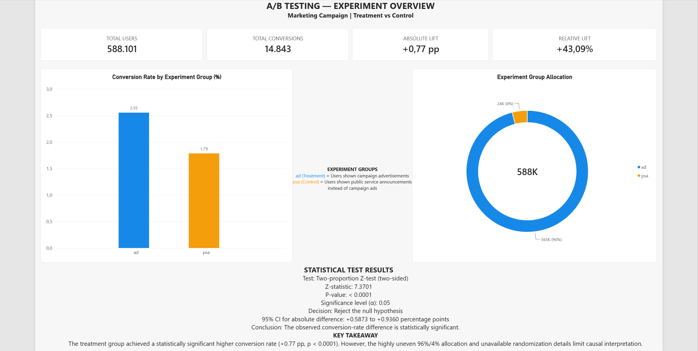
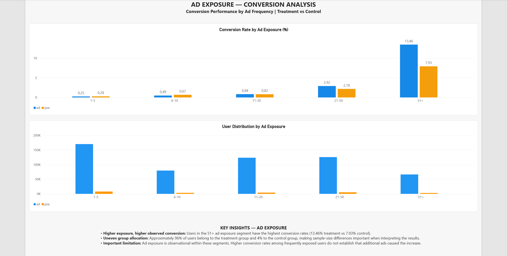
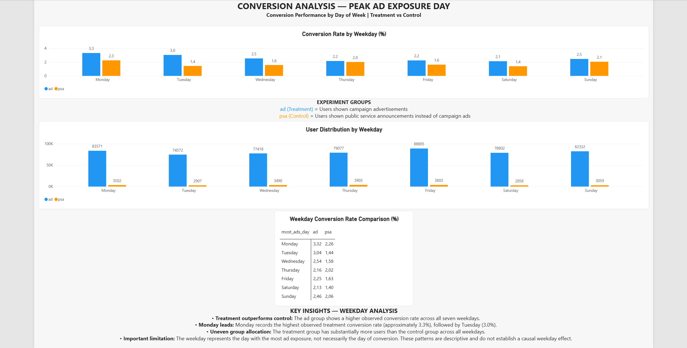
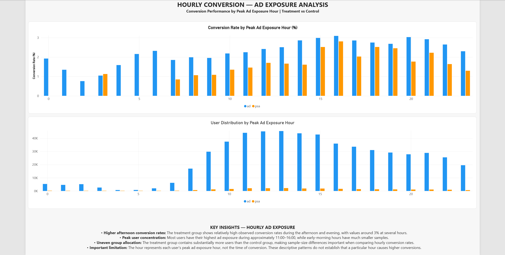

# A/B Testing & Conversion Analysis

**Marketing Campaign Performance | SQL • Python • Statistical Testing • Power BI**

An end-to-end marketing analytics project analyzing **588,101 users** to evaluate conversion performance between a treatment group exposed to campaign advertisements and a control group exposed to public service announcements.

The project combines **MySQL data preparation, Python statistical hypothesis testing, and a four-page Power BI dashboard** to communicate experimental results, explore user behavior, and identify opportunities for further marketing analysis.

---

## Project Highlights

| KPI | Result |
|---|---:|
| Total Users | **588,101** |
| Total Conversions | **14,843** |
| Treatment Conversion Rate | **2.55%** |
| Control Conversion Rate | **1.79%** |
| Absolute Conversion Lift | **+0.77 percentage points** |
| Relative Conversion Lift | **+43.09%** |
| Statistical Significance | **p < 0.0001** |

**Main finding:** The treatment group achieved a statistically significantly higher observed conversion rate than the control group.

**Important caveat:** The 96%/4% allocation and unavailable randomization details limit causal interpretation.

---

## Power BI Dashboard

The interactive Power BI dashboard consists of four analytical pages.

### 1. Experiment Overview



Presents experiment KPIs, treatment versus control conversion rates, user allocation, absolute and relative lift, statistical significance, and confidence intervals.

### 2. Ad Exposure Analysis



Explores conversion rates and user distribution across advertisement exposure frequency segments.

### 3. Weekday Conversion Analysis



Examines conversion performance by the weekday of each user's highest advertisement exposure, including group-level comparisons.

### 4. Hourly Conversion Analysis



Analyzes conversion rates and user distribution across 24 peak advertisement exposure hours.

**Power BI dashboard:** [AB_Testing_Conversion_Dashboard.pbix](04_PowerBI/AB_Testing_Conversion_Dashboard.pbix)

---

## Business Questions

This project addresses the following questions:

1. How does conversion performance differ between the treatment and control groups?
2. Is the observed difference statistically significant?
3. How do conversion rates vary across advertisement exposure frequency?
4. What conversion patterns appear across peak advertisement exposure weekdays?
5. How does conversion performance vary by peak advertisement exposure hour?

---

## Dataset

**Source:** [Marketing A/B Testing — Kaggle](https://www.kaggle.com/datasets/faviovaz/marketing-ab-testing)

The dataset contains **588,101 user-level records**.

### Experiment Groups

| Group | Description |
|---|---|
| `ad` — Treatment | Users shown campaign advertisements |
| `psa` — Control | Users shown public service announcements instead of campaign advertisements |

### Dataset Variables

| Variable | Description |
|---|---|
| `user_id` | Unique user identifier |
| `test_group` | Experiment group assignment |
| `converted` | Binary conversion outcome (0 or 1) |
| `total_ads` | Total advertisement exposures |
| `most_ads_day` | Weekday with the highest advertisement exposure |
| `most_ads_hour` | Hour with the highest advertisement exposure |

---

## Tools & Technologies

| Technology | Purpose |
|---|---|
| **MySQL** | Data import, cleaning, validation and transformation |
| **SQL** | Data quality checks and analytical data preparation |
| **Python** | Statistical testing and conversion analysis |
| **Pandas** | Data manipulation and aggregation |
| **Statsmodels** | Two-proportion Z-test and confidence interval estimation |
| **Power BI** | Interactive dashboard development |

---

## Data Preparation & Quality Checks

The raw dataset was imported into MySQL and transformed into a cleaned analytical table.

The data validation process included:

- Checking for missing values and invalid records.
- Verifying the uniqueness of user identifiers.
- Validating conversion outcomes.
- Checking weekday and hourly categories.
- Reviewing advertisement exposure distributions.
- Converting Boolean conversion values into binary indicators.

### Data Quality Results

| Validation Check | Result |
|---|---|
| Original Records | 588,101 |
| Clean Records | 588,101 |
| Unique Users | 588,101 |
| Missing Values | None identified |
| Duplicate User IDs | None identified |
| Invalid Conversion Values | None identified |

All records were retained, including observations with unusually high advertisement exposure counts.

---

## Experiment Results

### Treatment vs Control

| Metric | Treatment (`ad`) | Control (`psa`) |
|---|---:|---:|
| Users | 564,577 | 23,524 |
| Conversions | 14,423 | 420 |
| Conversion Rate | 2.5547% | 1.7854% |
| User Allocation | ~96% | ~4% |

### Conversion Lift

**Absolute lift:** +0.7692 percentage points.

**Relative lift:** +43.09%.

The treatment group achieved a higher observed conversion rate than the control group.

The relative lift represents a proportional increase in conversion rate, not a 43.09-percentage-point increase.

---

## Statistical Hypothesis Testing

A **two-sided two-proportion Z-test** was used to determine whether the conversion rates differed significantly between the two experiment groups.

### Hypotheses

- **H₀ (Null Hypothesis):** Treatment and control conversion rates are equal.
- **H₁ (Alternative Hypothesis):** Treatment and control conversion rates are different.

### Statistical Results

| Measure | Result |
|---|---|
| Statistical Test | Two-proportion Z-test |
| Alternative Hypothesis | Two-sided |
| Z-statistic | 7.3701 |
| P-value | < 0.0001 |
| Significance Level | 0.05 |
| 95% Confidence Interval | +0.5873 to +0.9360 percentage points |
| Decision | Reject the null hypothesis |

### Interpretation

The difference in observed conversion rates is statistically significant at the 5% significance level.

The 95% confidence interval for the absolute difference is entirely above zero, supporting the conclusion that the treatment group had a higher observed conversion rate.

However, statistical significance alone does not establish causality. The dataset does not document the intended group allocation or randomization procedure.

---

## Exploratory Analysis

### 1. Advertisement Exposure Frequency

Users were segmented into five advertisement exposure groups.

| Exposure Segment | Treatment Conversion Rate | Control Conversion Rate |
|---|---:|---:|
| 1–5 ads | 0.25% | 0.28% |
| 6–10 ads | 0.49% | 0.67% |
| 11–20 ads | 0.84% | 0.82% |
| 21–50 ads | 2.92% | 2.18% |
| 51+ ads | 13.46% | 7.93% |

**Key finding:** The highest observed conversion rates occurred among users exposed to 51 or more advertisements.

**Interpretation:** Higher advertisement exposure is associated with higher observed conversion rates in some segments, but these comparisons do not demonstrate that additional exposure caused the increase.

### 2. Peak Advertisement Exposure Weekday

Conversion performance was analyzed according to the weekday when users received the most advertisement exposure.

| Weekday | Treatment Conversion Rate | Control Conversion Rate |
|---|---:|---:|
| Monday | 3.32% | 2.26% |
| Tuesday | 3.04% | 1.44% |
| Wednesday | 2.54% | 1.58% |
| Thursday | 2.16% | 2.02% |
| Friday | 2.25% | 1.63% |
| Saturday | 2.13% | 1.40% |
| Sunday | 2.46% | 2.06% |

**Key findings:**

- Treatment demonstrated a higher observed conversion rate across all seven weekday categories.
- Monday had the highest treatment conversion rate, followed by Tuesday.
- Sample sizes differed between the experimental groups across weekdays.

**Interpretation:** The weekday variable represents peak advertisement exposure, not the actual conversion day.

### 3. Peak Advertisement Exposure Hour

Conversion performance was analyzed across 24 hourly categories.

**Key findings:**

- Treatment conversion rates were relatively high during several afternoon and evening exposure categories.
- Several hourly treatment conversion rates were approximately 3%.
- The largest user concentrations occurred around 11:00–16:00.
- Early-morning categories had substantially smaller samples.

**Interpretation:** Peak advertisement exposure hour is not equivalent to conversion time. These patterns are descriptive and do not establish a causal effect of advertising at specific hours.

---

## Business Implications

### Campaign Effectiveness

The statistically significant conversion-rate difference supports further investigation of the campaign's effectiveness, subject to verification of the experiment design.

### Advertisement Exposure

Higher observed conversion rates among frequently exposed users suggest opportunities for further analysis of exposure frequency and engagement.

A controlled experiment would be necessary to estimate the incremental effect of additional advertisement exposures.

### Campaign Timing

Weekday and hourly exposure patterns may help generate hypotheses for future experiments, but should not be interpreted as evidence of optimal advertising schedules.

### Experiment Design

Future A/B tests should document:

- Intended allocation ratios.
- Randomization procedures.
- Sample-size requirements.
- Primary success metrics.
- Experiment duration and stopping rules.

---

## Limitations

1. **Uneven group allocation:** Approximately 96% of users belong to treatment and 4% to control. The planned allocation ratio is unknown; therefore, a sample ratio mismatch cannot be established from the observed split alone.
2. **Unknown randomization:** The available dataset does not document how users were assigned to groups.
3. **Observational exposure patterns:** Higher exposure frequency may be associated with other user behaviors or characteristics.
4. **No conversion timestamps:** Weekday and hour variables represent peak exposure rather than actual conversion timing.
5. **Limited business context:** Campaign costs, revenue per conversion, and profitability metrics are unavailable.
6. **Exploratory subgroup analysis:** Weekday, hourly and exposure-segment differences are descriptive rather than independently established causal effects.

---

## Project Structure

```text
AB_Testing_Conversion_Analysis/
│
├── 01_Data/
│   ├── marketing_AB.csv
│   └── ab_test_clean.csv
│
├── 02_SQL/
│   ├── 01_create_tables.sql
│   ├── 02_import_data.sql
│   ├── 03_data_quality_checks.sql
│   └── 04_data_transformation.sql
│
├── 03_Python/
│   ├── 01_validate_dataset.py
│   └── 02_ab_test_analysis.py
│
├── 04_PowerBI/
│   ├── ab_test_daily.csv
│   ├── ab_test_exposure.csv
│   ├── ab_test_hourly.csv
│   ├── ab_test_summary.csv
│   └── AB_Testing_Conversion_Dashboard.pbix
│
├── 05_Screenshots/
│   ├── 01_Experiment_Overview.png
│   ├── 02_Ad_Exposure_Analysis.png
│   ├── 03_Weekday_Conversion_Analysis.png
│   └── 04_Hourly_Conversion_Analysis.png
│
└── README.md
```

---

## Conclusion

This project demonstrates a complete analytics workflow, from raw data preparation and validation to statistical hypothesis testing and interactive business intelligence reporting.

The treatment group achieved a **2.55% conversion rate**, compared with **1.79%** for the control group, resulting in an **absolute lift of approximately 0.77 percentage points** and a **relative lift of 43.09%**.

The observed difference was statistically significant (**p < 0.0001**).

Exploratory analysis identified additional patterns across advertisement exposure frequency, peak exposure weekdays, and peak exposure hours.

The project demonstrates the importance of combining technical analysis, statistical reasoning, and careful interpretation when evaluating marketing experiments.

---

## Author

**Dimitris Votsis**

[GitHub](https://github.com/dvotsis-data) | [LinkedIn](https://www.linkedin.com/in/dimitris-votsis/)